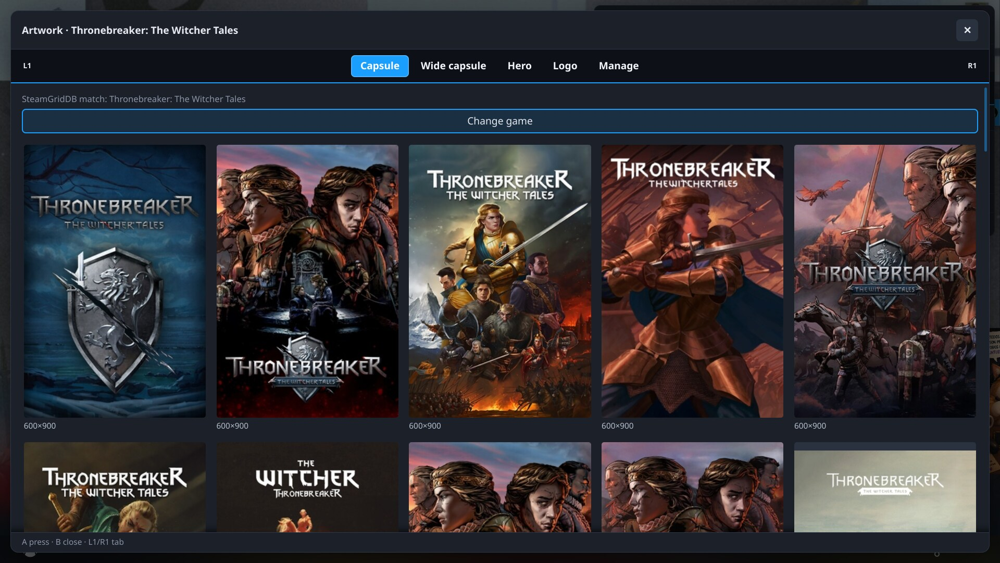
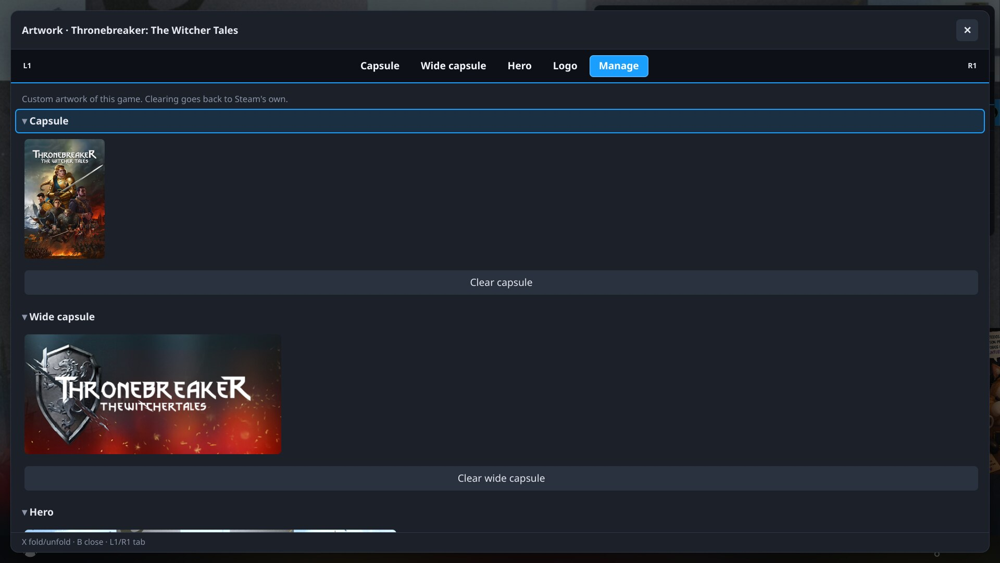

# Artwork

A module for [Invasor](../invasor) to browse community artwork from [steamgriddb.com](https://www.steamgriddb.com) and apply it to your Steam games and non-Steam shortcuts, from Steam's gamepad UI.

- **What it changes:** capsule, wide capsule, hero and logo. Animated art is previewed and can be applied too.
- **Manage:** clears custom art. **Change game** picks the right SteamGridDB entry for a shortcut.
- **How it applies art:** the image you pick is downloaded by Invasor's core (only from SteamGridDB, over https; it shows in the Tasks panel and is logged as a file you chose), then written as Steam's own file in `userdata/<account>/config/grid` of the account Steam is using. When Steam offers it, the library refreshes at once; otherwise the art shows after restarting Steam.
- **Big images:** over 20 MB, Artwork asks before keeping it (its size isn't known in advance, so the first 20 MB are downloaded before it asks, and again if you say yes). Nothing over 100 MB is downloaded.

## Screenshots

<p align="center">
  
  
</p>

## Requirements
- Invasor 0.3.0 or newer (`min_core`): it uses `ctx.http` to download the image you picked and `ctx.paths` to find the account's grid folder.
- Your own SteamGridDB API key (free): steamgriddb.com → log in with Steam → Preferences → API. Paste it in the module's Settings; it is shown as dots (masked on screen only, it is stored as plain text on your device).

## Build, test and install
With the core checked out next to this repository (`../invasor`):

```sh
python3 ../invasor/tools/pack_module.py artwork       # build, check, tests -> artwork-<version>.zip
python3 ../invasor/tools/install_module.py artwork    # or install that zip from ⚙ Settings › Install module
```

## Credits
Images and API: steamgriddb.com and its community of artists; please respect their work. Inspired by [decky-steamgriddb](https://github.com/SteamGridDB/decky-steamgriddb) by the SteamGridDB team (GPL-3.0). Artwork is not affiliated with SteamGridDB. Please don't report problems with this module to them.

## License
[GNU General Public License v3.0 or later](LICENSE) (GPL-3.0-or-later).
